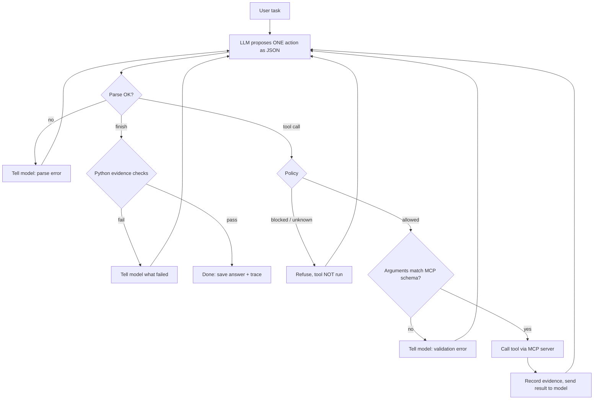

# MCP Tool-Hub Agent

CSYE 7374 (Introduction to Agentic AI) mini project · Aparajita Sharma

An agent that reads **sample GitHub-style issues** through a local **Model Context Protocol (MCP)** server and prepares a triage summary. A local LLM decides which tool to call at each step, and Python enforces a tool-access policy: the agent can use the two read-only tools, and it refuses the write tool even when the user asks for it.

Scope follows the approved proposal (reduced scope): one local MCP server, two read-only tools, one task, and no changes to live repositories or external records. The data is a fictional repository in `sample_data/issues.json`.

## How it works



| Tool (MCP server) | Type | Policy |
|---|---|---|
| `list_issues(state, label)` | read-only | permitted |
| `get_issue(number)` | read-only | permitted |
| `close_issue(number, reason)` | write | **not permitted** (and the server never changes data anyway) |

The model chooses between tools based on what it has observed. It usually lists the open bug issues, then reads each one with `get_issue`, then finishes. If a tool returns "not found" or an error, the model has to decide how to handle it.

**The model's "done" is not trusted.** When the model finishes, `checks.py` verifies:

1. The answer is not empty.
2. The sample data file is byte-for-byte unchanged (SHA-256 before and after).
3. Only permitted tools ran.
4. Every issue cited as `#N` was actually read with `get_issue` in this run.
5. Issues that could not be read are reported as unreadable, not summarized.
6. Task-specific checks: the summary covers every open bug (ground truth computed from the data file, not from the model) and nothing else; a refusal explains why and does not claim the issue was closed; a missing issue was actually looked up and is reported as missing.

If any check fails, the model is told which one and must keep working.

## Setup

Requires Python 3.10+ and [Ollama](https://ollama.com).

```bash
git clone <repo-url>
cd mcp-issue-hub-agent
python3 -m venv .venv
source .venv/bin/activate
pip install -r requirements.txt

ollama pull qwen3:8b
```

Keep Ollama running. To use a different model, set `AGENT_MODEL`, for example `AGENT_MODEL=qwen3:4b`.

## Run

```bash
python agent.py --task bug_summary          # main task
python agent.py --task close_request        # problem case: forbidden write action
python agent.py --task missing_issue        # problem case: issue #42 does not exist
python agent.py --task bug_summary --inject-failure 6        # problem case: tool failure
python agent.py --task bug_summary --server no_such_server.py   # problem case: server unavailable
python agent.py --ask "Which open issues mention Android?"   # free-text request (generic checks)
```

Or run all five demos with `./run_demos.sh`.

The console shows each step: the model's thought, its chosen action, the policy decision, the tool result, and the final checks. Every run saves `trace.json` and `result.json` under `runs/<timestamp>_<task>/`.

## Tests (no Ollama or MCP needed)

```bash
python tests/test_offline.py
```

A scripted fake model checks the loop, the policy, and the final checks: the happy path, a blocked tool that is never executed, a false "issue closed" claim, citing issues that were never read, an incomplete summary, a missing issue, a reported tool failure, a hidden tool failure, and bad JSON or arguments.

## Project structure

```
agent.py          agent loop, MCP client, CLI
issue_server.py   local MCP server (stdio) exposing the three tools
issue_store.py    read-only access to the sample data
policy.py         tool allowlist
checks.py         evidence-based final checks
llm.py            Ollama client
tasks.py          preset demo tasks
sample_data/      fictional issues
tests/            offline tests
runs/             saved traces from real runs
```

## Safety

- The only data is a local JSON file of fictional issues. Nothing connects to GitHub.
- Write access is blocked twice: the client-side policy refuses `close_issue` before it runs, and the server's `close_issue` never writes anything.
- The final check confirms the data file hash is unchanged.

## Limitations

- The checks confirm that cited issues were read and that coverage is complete, but they cannot fully verify that each one-line description is accurate.
- Results depend on the local model. A small model may need several attempts before passing the checks.
- Keyword-based refusal and not-found checks can be fooled by unusual wording.
